# The Full Dev Cycle

[START-HERE.md](START-HERE.md) answers *"I'm stuck right now, what do I say?"* This one answers *"what does the whole arc look like, and where does it go wrong?"*

Nine phases. It's a loop, not a waterfall — the feedback edges are the point, and every one of them is a real failure I've watched happen. **The coral nodes are where new information enters the system.** Nothing improves in a pass that doesn't contain one.

```mermaid
flowchart TD

subgraph P0["0 · Intent"]
    IDEA([The idea]):::term
    BAR[Name a real thing to beat<br/>not 'good', not 'AAA' — rule 32]:::act
    UNC[Map your own uncertainty<br/>what you know vs guess — rule 5]:::key
end

subgraph P1["1 · Literacy"]
    G1{Does anyone<br/>know how?}:::gate
    DATA[Stand up a dataset<br/>measure, scrape, benchmark — rule 17]:::key
    TEACH[Teach-back until YOU understand<br/>plain language, no code yet — rule 15]:::key
    G2{Do you understand<br/>it now?}:::gate
end

subgraph P2["2 · Design"]
    SCHEM[Schematic to a file<br/>modules, flow, state — rule 14]:::key
    EDGE[Name the boundary<br/>what enters and leaves — rule 16]:::key
    DEC[Decompose into work units<br/>+ one shared contract file — rules 39, 41]:::act
end

subgraph P3["3 · Scaffold"]
    PROBE[Probes and harness FIRST<br/>before any feature — rule 18]:::act
    CONST[Constraints, versions, licences<br/>stated up front — rules 10, 11]:::act
end

subgraph P4["4 · Build"]
    FAN[Nested fan-out<br/>each node splits again — rule 41]:::act
    LOOP[Every node loops to its own bar<br/>loop-until, not deliver — rules 6, 31]:::act
    CRIT[Every node has its own critic<br/>never the maker — rule 20]:::key
    G3{Node cleared<br/>its bar?}:::gate
end

subgraph P5["5 · Verify"]
    PROVE[Prove by execution<br/>paste the output — rule 19]:::act
    BLIND[Blind compare vs a REAL file<br/>reference on disk — rule 21]:::key
    SKIP[What did you skip or stub?<br/>rules 23, 24]:::act
    G4{Clears the<br/>stated bar?}:::gate
end

subgraph P6["6 · Integrate"]
    RECON[Reconcile siblings vs the contract<br/>they could not see each other]:::act
    E2E[End to end on REAL data<br/>through the actual boundary]:::key
    G5{Works whole?}:::gate
end

subgraph P7["7 · Harden"]
    HOST[Wrong, absent, hostile, slow<br/>every edge case at the boundary — rule 16]:::act
    REPRO[Reproducible from a clean machine<br/>+ licence audit — rule 11]:::act
end

subgraph P8["8 · Ship and fold back"]
    SHIP([Ship]):::term
    CAP[Write what was learned to disk<br/>specs, gotchas, decisions — rule 39]:::key
    G6{Will this<br/>recur?}:::gate
    TOOL[Make it an engine<br/>targets become inputs — rule 37]:::act
    NEXT([Next cycle]):::term
end

IDEA --> BAR --> UNC --> G1
G1 -->|Nobody does| DATA --> TEACH
G1 -->|It does, I do not| TEACH
G1 -->|I know it cold| SCHEM
TEACH --> G2
G2 -->|No, it hand-waves| DATA
G2 -->|Yes| SCHEM
SCHEM --> EDGE --> DEC --> PROBE --> CONST --> FAN --> LOOP --> CRIT --> G3

G3 -->|No, still gaining| LOOP
G3 -->|Stuck 2 passes| RES[STOP. Research<br/>escalate the tool — law 2, rule 27]:::act
G3 -->|Criteria keep shrinking| HEAT[Soft heat death<br/>the spec is wrong — rule 28]:::key
G3 -->|No, and plateaued| PLAT[Bank it, report the ceiling<br/>budget spent — rule 33]:::act
G3 -->|Yes| PROVE
RES --> LOOP
HEAT --> TEACH
PLAT --> PROVE

PROVE --> BLIND --> SKIP --> G4
G4 -->|No — wrong build| LOOP
G4 -->|No — wrong aim| BAR
G4 -->|Yes| RECON
RECON --> E2E --> G5
G5 -->|No — boundary was wrong| EDGE
G5 -->|No — units disagree| DEC
G5 -->|Yes| HOST
HOST --> REPRO --> SHIP --> CAP --> G6
G6 -->|Yes| TOOL --> NEXT
G6 -->|No| NEXT

classDef term fill:#1D9E75,stroke:#0F6E56,color:#ffffff
classDef key fill:#FAECE7,stroke:#993C1D,color:#4A1B0C
classDef act fill:#EEEDFE,stroke:#534AB7,color:#26215C
classDef gate fill:#F1EFE8,stroke:#5F5E5A,color:#2C2C2A
```

---

## What each phase is actually for

The middle column is what you say. The right column is the specific failure that phase exists to prevent — skip the phase and you get that failure, reliably.

| Phase | What you say | The failure it prevents |
|---|---|---|
| **0 · Intent** | "Build X. It should beat *this named thing*. Here's what I know cold and here's what I'm guessing at." | The model supplies its own bar and lands on the median. Your guesses get built as if they were specifications. |
| **1 · Literacy** | "Explain how this works in plain language until I understand it. Don't write code yet." | You spec a domain you don't understand, nothing QAs it, and the whole build inherits the mistake — **soft heat death** starts here. |
| **2 · Design** | "Map it to a file. Where does real data enter and leave? Split it into units and write a contract they all read." | Assumptions stay invisible until they're load-bearing. Sibling agents make incompatible choices nobody notices until integration. |
| **3 · Scaffold** | "Build the probes and the harness before any feature. Here are the hard constraints." | Errors you cannot see by reasoning — scale, orientation, timing — stay invisible. Constraints arrive after the build and invalidate it. |
| **4 · Build** | "Fan out, let those fan out. Every node loops to its own bar with its own harsh critic." | One pass, self-graded, stopped at first plausible output. Errors bubble to a root critic that can only say "it looks off." |
| **5 · Verify** | "Run it and paste the output. Compare blind against the reference on disk. What did you skip?" | Plausible-but-wrong survives an approving read. A benchmark judged from memory instead of from a real artifact. |
| **6 · Integrate** | "Reconcile everything against the contract, then run it end to end on real data." | Every part passes alone and the whole thing doesn't work — the classic fan-out failure. |
| **7 · Harden** | "Now: wrong input, absent input, hostile input, slow input. Rebuild it from a clean machine." | A demo that works only on the happy path, only on your machine, with a licence you can't ship. |
| **8 · Fold back** | "Write down what we learned. Should this be a tool?" | Paying for the same discoveries next project. Doing by hand, fifty times, a thing that could be a script. |

---

## The five loops that matter

A waterfall version of this chart would be worthless. These are the edges that make it a cycle, and each one is a specific diagnosis:

1. **Build → Build** *(node hasn't cleared its bar, gains continuing)* — normal. This is the loop doing its job.
2. **Build → Literacy** *(acceptance criteria shrinking)* — soft heat death. The spec is wrong, so iterating harder reinforces the error. Go back to the teach-back; only outside information escapes this.
3. **Verify → Intent** *(built the wrong thing)* — a targeting failure, not a quality one. Fix the aim in one sentence rather than the artifact in twenty.
4. **Integrate → Design** *(units disagree)* — the contract was underspecified. The parts each satisfied a different reading of it.
5. **Integrate → Design (boundary)** *(everything works, nothing connects to reality)* — the classic Open-request failure arriving late. The interior was built beautifully and the edges were assumed.

Loop 2 is the expensive one. It's the only failure that *looks like progress* while it's happening.
