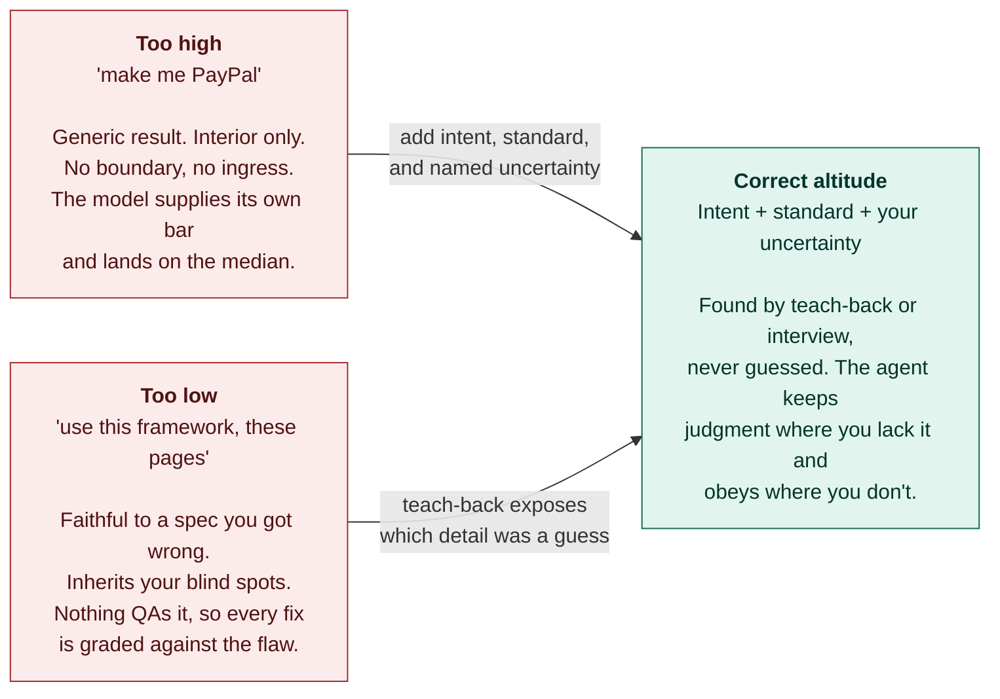
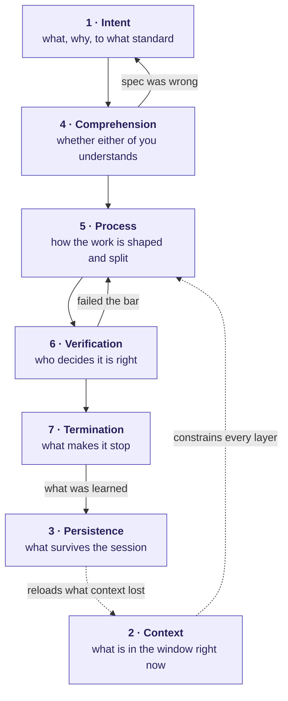

# The Map

Everything else in this repo is advice. This is the **structure underneath it** — the seven surfaces you actually control when working with an agent, what breaks when you don't manage each one, and where our rules and the published research land on it.

Organised by control surface, not by tip. Tips are endless; the surfaces are seven.

---

## The axis that runs through everything: altitude

Anthropic's context-engineering work names a variable they call **system prompt altitude** — the balance between "brittle hardcoded logic" and "vague guidance." It's the same axis the three ways to ask sit on, approached from the other side, and it explains why both of our failure examples are the *same* failure at different heights.

Both edges produce work that *looks* finished. That's why altitude has to be found by dialogue rather than chosen up front — you cannot detect your own altitude error from inside the prompt.

---

## The seven control surfaces

Note the two dotted edges and the two return edges — those are why this isn't a checklist. Context constrains everything simultaneously; persistence is how you refill context after it's lost; and both verification and comprehension send you *backwards* when they fail.

---

### 1 · Intent — altitude, standard, and honest uncertainty

| | |
|---|---|
| **The knob** | How much of the HOW you fix, and whether you mark which parts are guesses |
| **Unmanaged failure** | Median output (too high) or faithful-to-a-wrong-spec (too low) → **soft heat death** |
| **Our rules** | Part 0, #5 map your uncertainty, #32 name a real benchmark, #35 ask for what you want |
| **Named externally** | *System prompt altitude* — Anthropic, effective context engineering |

The non-obvious part: **two HOWs, opposite advice.** How the artifact works → specify only where you know. How the *work* runs → specify always, in full. The second needs no domain expertise, so it can never be the source of a wrong spec.

---

### 2 · Context — the fundamental constraint

| | |
|---|---|
| **The knob** | What enters the window, when, and what leaves |
| **Unmanaged failure** | **Context rot** — recall accuracy falls as tokens grow. Earlier instructions get "forgotten." |
| **Our rules** | #7 paths not pastes, #12 reduce locally, #13 budget not bucket, #30 restart beats untangling, #38 one mission, #40 delegate the searching, #41 nest the fan-out |
| **Named externally** | *Context rot*, *attention budget*, *just-in-time retrieval*, *compaction*, *sub-agent architectures* — Anthropic |

Three official mechanisms worth knowing by name:

- **Attention budget** — finite, like working memory. Every token spends some. Quality of tokens beats quantity, always.
- **Just-in-time retrieval** — hold lightweight identifiers (paths, queries, links) and load the content at the moment of use, rather than pre-loading. This is exactly why #7 works, and it's the agent-side version of the same discipline.
- **Compaction** — summarise a nearly-full window and reinitialise from the summary. Automatic in Claude Code; you can steer what survives it.

The official framing is blunt and matches ours: *"Most best practices are based on one constraint: the context window fills up fast, and performance degrades as it fills."*

---

### 3 · Persistence — the enforcement ladder

This is the surface most people never think about, and it has a strict ordering.

| Mechanism | Lifetime | Strength | Costs you |
|---|---|---|---|
| The prompt | This turn | Advisory | Nothing |
| `CLAUDE.md` | Every session, always loaded | Advisory | **Attention budget, permanently** |
| Skills (`SKILL.md`) | Loaded on demand when relevant | Advisory | Nothing until used |
| Hooks | Fires deterministically at a lifecycle point | **Guaranteed** | Setup |
| A script / an engine | Runs the same way forever | **Guaranteed** | Setup |

| | |
|---|---|
| **The knob** | Where you put a rule, and how hard it binds |
| **Unmanaged failure** | A must-always requirement written as advice. Or a bloated always-on file where **rules get lost in the noise and Claude ignores half of it.** |
| **Our rules** | #34 checkpoint to files, #37 build the engine, plus new #43–#44 |
| **Named externally** | Anthropic best practices: *"Hooks are deterministic; CLAUDE.md instructions are advisory."* |

The diagnostic is the good bit, and it's counter-intuitive: **if the agent keeps breaking a rule you wrote down, the file is probably too long and the rule is being drowned — not that the rule was unclear.** The fix is pruning, not rephrasing. Official test for every line: *"would removing this cause a mistake?"* If not, cut it.

Corollary: broadly-applicable → always-loaded memory. Situational → a skill, loaded on demand. Non-negotiable → a hook.

---

### 4 · Comprehension — the only layer that upgrades *you*

| | |
|---|---|
| **The knob** | Whether the design survives translation into plain language before it's built |
| **Unmanaged failure** | You spec a domain you don't understand; nothing questions it; the whole build inherits it |
| **Our rules** | #14 schematic, #15 teach-back, #16 boundary, #17 stand up a dataset |
| **Named externally** | Anthropic best practices: *let Claude interview you* → write `SPEC.md` → **execute in a fresh session** |

Two directions, and you want both:

- **Teach-back** — it explains to you. Good when you know enough to spot a wrong explanation.
- **Interview** — it questions you, via `AskUserQuestion`. Better when *you don't know what you don't know*, because it doesn't require you to know which questions to ask. Official guidance: "dig into the hard parts I might not have considered."

Both end at a written spec, and the spec is executed in a **clean session** — comprehension work is context-expensive, and implementation shouldn't inherit that cost. The official spec quality bar: name the files and interfaces, state what is out of scope, end with an end-to-end verification step.

---

### 5 · Process — the shape of the work

| | |
|---|---|
| **The knob** | Plan or don't; split or don't; how deep the split goes |
| **Unmanaged failure** | One pass, one agent, self-graded, stopped at first plausible output. Or the reverse: planning ceremony on a one-line change. |
| **Our rules** | #6 specify the work shape, #18 probe before feature, #41 nest the fan-out, #37 build the engine |
| **Named externally** | *Explore → plan → code → commit*; *fan out across files*; *writer/reviewer sessions* — Anthropic best practices |

The nuance our doc was missing, and it's an honest one: **planning has overhead.** Official rule of thumb — *if you could describe the diff in one sentence, skip the plan.* Plan when you're uncertain about the approach, when it spans multiple files, or when the code is unfamiliar. Not otherwise.

---

### 6 · Verification — the gate gradient

Not binary. There's a ladder, and each rung trades setup effort for attention you no longer have to spend.

| Rung | Mechanism | Strength |
|---|---|---|
| 1 | "Run the check and iterate" in the prompt | Works today, no setup |
| 2 | A session-level goal condition, re-checked every turn | Survives the whole session |
| 3 | A **Stop hook** that blocks the turn from ending until a script passes | Deterministic |
| 4 | A **separate subagent** in fresh context that tries to refute the result | Catches what a script can't judge |

| | |
|---|---|
| **The knob** | How hard the gate is, and who holds it |
| **Unmanaged failure** | *The trust-then-verify gap* — a plausible-looking implementation that doesn't handle edge cases |
| **Our rules** | #19 prove by execution, #20 split maker from judge, #21 blind against a real artifact, #22–#25 interrogation |
| **Named externally** | Anthropic: *"a fresh context improves code review since Claude won't be biased toward code it just wrote"* |

That quote is the exact mechanism behind #20, confirmed from the source.

**The counterweight we were missing, and it's important:** a reviewer told to find gaps *will* report some, even when the work is sound — because that's the assigned task. Chasing every finding produces over-engineering: needless abstraction, defensive code, tests for impossible cases. **So scope the critic:** flag only what affects correctness or the stated requirements; everything else is optional. Adversarial review has a false-positive cost, and pretending otherwise is how you get a bloated codebase that passed every review.

---

### 7 · Termination — the layer nobody writes

| | |
|---|---|
| **The knob** | What event ends the work |
| **Unmanaged failure** | Official phrasing, and it's the whole problem in one line: **"Claude stops when the work looks done. Without a check it can run, 'looks done' is the only signal available, and you become the verification loop."** |
| **Our rules** | #31 always state the stop condition, #33 pair an unreachable bar with a budget |
| **Named externally** | Anthropic best practices, *give Claude a way to verify its work* |

A stop condition is a **loop-until**, not a deliverable. "Build X" terminates on first plausible output. "Keep going until Y passes" terminates on a standard. The difference is the entire gap between a session you have to watch and one you can walk away from.

---

## Where the map disagrees with itself

Honest tensions. Anyone who tells you these resolve cleanly hasn't run enough sessions.

| Tension | How it actually resolves |
|---|---|
| "Be specific" **vs** "detail transfers authority" | Specific about *what* and *how the work runs*; not about domain HOW you're guessing at. Two different HOWs. |
| "Give more context" **vs** "context rot" | More *relevant* context, less total. Pointers over payloads; retrieve at the moment of use. |
| "Adversarial review" **vs** "over-eager reviewers" | Assign harshness AND scope it to correctness and stated requirements. |
| "Plan first" **vs** "planning has overhead" | One-sentence diff → skip it. Unfamiliar or multi-file → plan. |
| "Vague prompts are lazy" **vs** *"what would you improve here?"* | Vague is for **exploration** where you can afford to course-correct; precise is for **execution**. Never confuse the two modes. |
| "Permission to fail" **vs** cost of failure | Make rollback cheap — checkpoints, branches, worktrees. Then risk is genuinely cheap rather than merely permitted. |

---

## The five named failure patterns worth memorising

From the official guidance, all five confirmed against our own experience:

1. **The kitchen sink session** — unrelated tasks in one window. → new session.
2. **Correcting over and over** — context polluted with failed approaches. → after **two** failed corrections, clear and rewrite the prompt with what you learned. (Independently the same threshold as our Law 2.)
3. **The over-specified always-on file** — too long, so rules get lost. → prune ruthlessly.
4. **The trust-then-verify gap** — plausible implementation, unhandled edges. → always provide a check; if you can't verify it, don't ship it.
5. **The infinite exploration** — unscoped "investigate this," hundreds of files read. → scope it, or send a subagent so it doesn't cost your window.

---

## Sources

- [Best practices for Claude Code](https://code.claude.com/docs/en/best-practices) — Anthropic
- [Effective context engineering for AI agents](https://www.anthropic.com/engineering/effective-context-engineering-for-ai-agents) — Anthropic Engineering
- [Claude Code prompt library](https://code.claude.com/docs/en/prompt-library) — Anthropic
- [Context engineering: memory, compaction, and tool clearing](https://platform.claude.com/cookbook/tool-use-context-engineering-context-engineering-tools) — Claude Cookbook
- [awesome-claude-md](https://github.com/josix/awesome-claude-md) and [TakatoPhy/awesome-claude-md](https://github.com/TakatoPhy/awesome-claude-md) — community `CLAUDE.md` collections
- [Awesome Claude Code directory](https://awesomeclaude.ai/awesome-claude-code) — community index
- [Context Engineering: A Practical Guide for AI Agents](https://sourcegraph.com/blog/context-engineering) — Sourcegraph

Everything not attributed above came from our own sessions.
