# Start Here — The Decision Flowchart

The [rules](README.md) sorted by *situation* instead of by number. Find where you are, take the move.

The first two questions are the important ones. Everything after them is recovery from getting those wrong.

*Looking for the whole arc instead of one moment? That's [DEV-CYCLE.md](DEV-CYCLE.md).*

```mermaid
flowchart TD
    START([START HERE]):::term --> QA{Does your request have<br/>all three parts?}

    QA -->|Missing the task| P1[<b>Say what, and to what standard — rule 32</b><br/>Name a real product to beat.<br/>Not 'AAA', not 'professional'.]:::act
    QA -->|Missing the method| P2[<b>Say how the WORK runs — rules 6, 41</b><br/>Fan out, then let those fan out.<br/>Every node loops. Every node has a critic.]:::act
    QA -->|Missing the bar| P3[<b>Say when to stop — rules 31, 33</b><br/>Who judges, against what, and<br/>the budget if the bar is an asymptote.]:::key
    QA -->|All three| Q0

    P1 --> QA
    P2 --> QA
    P3 --> QA

    Q0{How much of the DOMAIN<br/>how do you actually know?}
    Q0 -->|Almost none| OPEN[<b>Say so — rule 5</b><br/>Give intent and admit the gap.<br/>Do not invent a spec to sound sure.]:::act
    Q0 -->|Some of it| MIX[<b>Tag which is which — rule 5</b><br/>Mark what you know cold<br/>and what you are guessing at.]:::act
    Q0 -->|All of it, genuinely| CLOSED[<b>Specify freely — rule 10</b><br/>Constraints, limits, versions.<br/>Detail is a win where you are right.]:::act

    OPEN --> TEACH
    MIX --> TEACH
    CLOSED --> Q1

    TEACH[<b>Demand the teach-back — rule 15</b><br/>Describe the plan in plain language<br/>until I understand it. No code yet.]:::key
    TEACH --> Q_UND{Does the explanation<br/>make sense to you?}

    Q_UND -->|No, it hand-waves a part| GAP{Does anyone<br/>actually know?}
    Q_UND -->|Yes| Q1

    GAP -->|It does, I just did not| TEACH
    GAP -->|Neither of us| DATA[<b>Stand up a dataset — rule 17</b><br/>Measure it. Scrape it. Benchmark it.<br/>Never agree on a mutual guess.]:::key
    DATA --> TEACH

    Q1{Does it know this<br/>codebase cold?}
    Q1 -->|No| SCHEM[<b>Schematic it — rule 14</b><br/>Map modules, data flow, state.<br/>Write to a file. Hand you a copy.]:::act
    Q1 -->|Yes| EDGE
    SCHEM --> EDGE

    EDGE[<b>Name the boundary — rule 16</b><br/>Where does real data enter and leave?<br/>What happens when it is wrong or absent?]:::key
    EDGE --> Q2{Will this task<br/>happen again?}

    Q2 -->|Yes| ENG[<b>Build the engine — rule 37</b><br/>Ask for the tool, then run the tool.]:::act
    Q2 -->|No| RUN
    ENG --> RUN

    RUN[It works the problem]:::neutral --> Q3{Did it get<br/>somewhere?}

    Q3 -->|Stuck| Q4{How many<br/>fix passes?}
    Q3 -->|Produced output| Q6{Is it aimed at<br/>the right thing?}

    Q4 -->|Under 2| RETRY[Let it try again]:::neutral
    RETRY --> RUN
    Q4 -->|It said 'I cannot'| WHY[<b>Push on why — rule 26</b><br/>Test the mechanism, do not theorize.<br/>A cannot is an undiagnosed why.]:::act
    Q4 -->|2 or more| RES[<b>STOP. Research — law 2, rule 27</b><br/>Read the source. Run a probe.<br/>Escalate the tool, not the effort.]:::act

    WHY --> Q5
    RES --> Q5
    Q5{Are the acceptance criteria<br/>getting SMALLER each pass?}
    Q5 -->|Yes| HEAT[<b>Soft heat death — rule 28</b><br/>Every fix is graded against your spec,<br/>not reality. Iterating cannot fix this.]:::key
    Q5 -->|No| Q5B{Three approaches<br/>failed?}

    HEAT --> TEACH
    Q5B -->|Yes| FRESH[<b>Fresh session — rule 30</b><br/>Wrong context is now the problem.<br/>Carry a written summary, not the thread.]:::act
    Q5B -->|No| RUN
    FRESH --> RUN

    Q6 -->|No| AIM[<b>Correct the aim — rule 29</b><br/>One sentence on the goal.<br/>Not twenty on the code.]:::act
    AIM --> RUN
    Q6 -->|Yes| PROVE[<b>Make it prove it — rule 19</b><br/>Run it. Paste the output.<br/>Do not ask whether it works.]:::act

    PROVE --> JUDGE[<b>A different agent grades it — rule 20</b><br/>Never the one that built it.<br/>Assign the harshness explicitly.]:::key
    JUDGE --> BLIND[<b>Blind, against a real file — rule 21</b><br/>Reference frames on disk, not memory.<br/>Do not tell it which one is ours.]:::key
    BLIND --> CHECK[<b>Interrogate — rules 22, 23, 24</b><br/>What is wrong with this?<br/>What did you skip or stub?<br/>Now argue against yourself.]:::act

    CHECK --> Q7{Did it clear<br/>the stated bar?}
    Q7 -->|No, and gains continue| RUN
    Q7 -->|No, and it has plateaued| PLAT[<b>Bank it — rule 33</b><br/>Budget spent. Report where<br/>the ceiling actually was.]:::act
    Q7 -->|Yes| Q8{Does it smell<br/>like a safe median?}

    Q8 -->|Yes| RISK[<b>Re-aim high — rules 34, 35</b><br/>I would rather you try the hard version<br/>and fail than hand me a safe partial.]:::act
    RISK --> RUN
    Q8 -->|No| Q9{Session long, or<br/>topic changed?}

    Q9 -->|Yes| HYG[<b>Reset — rules 38, 39</b><br/>New thread. Checkpoint to files.<br/>Chat compacts; disk does not.]:::act
    Q9 -->|No| DONE([Ship it, then loop]):::term
    HYG --> DONE
    PLAT --> DONE

    classDef term fill:#1D9E75,stroke:#0F6E56,color:#ffffff
    classDef key fill:#FAECE7,stroke:#993C1D,color:#4A1B0C
    classDef act fill:#EEEDFE,stroke:#534AB7,color:#26215C
    classDef neutral fill:#F1EFE8,stroke:#5F5E5A,color:#2C2C2A
```



The **coral** boxes are the ones doing the real work — the stop condition, teach-back, dataset, boundary, the separate blind judge, and the heat-death diagnosis. They're the only places new information enters the system, or where judgment moves outside the thing being judged. Everything in purple is technique; those are the difference between a project that climbs and one that settles.

---

## The three-part template

Copy this. Fill all three. The third is the one everyone drops.

```
THE TASK — what, and to what standard
  Build <thing>. It should match or beat <a real, named product>.
  <The parts I know cold: …>  <The parts I'm guessing at: …>

THE BUILD METHOD — how the work runs
  Fan out sub-agents, one per item — and let each fan out again.
  Loop every node until it passes; a separate sub-agent checks each,
  as a harsh critic, at the level where the detail still exists.
  All nodes read one shared contract file first, so siblings agree.
  Where nobody knows the answer, stand up a dataset instead of guessing.

THE BAR — when to stop
  Don't stop until <the separate critic>, comparing blind against
  <reference material on disk>, says ours wins.
  If it plateaus for <N> passes with no measurable gain,
  stop and report where the ceiling was.
```

---

## The same thing as a lookup table

| You are here | The move | Rules |
|---|---|---|
| Writing any prompt | All three parts: task, build method, bar | Part 0 |
| You only said what to build | Add how the work runs, and when to stop | 6, 31 |
| "Make it good / professional / AAA" | Name a real product to beat | 32 |
| The bar may be unreachable | Keep it, but add a budget and a plateau report | 33 |
| Starting anything | Say how much of the domain you actually know | 5 |
| You don't know the domain | "Think about it and explain it back before you build" | 15 |
| The explanation hand-waves a part | Push until it's plain, or go find ground truth | 15, 17 |
| Neither of you knows | Stand up a dataset — never agree on a guess | 17 |
| About to touch unfamiliar code | Schematic it, save it, hand back a copy | 14 |
| Any system at all | Ask where real data enters and leaves | 16 |
| Starting a build | State constraints and permission to fail | 10, 34 |
| Task will recur | Build the tool, then run the tool | 37 |
| Reporting a failure | Verbatim error, full trace | 8 |
| Sharing code | Paths, not pastes | 7 |
| Sharing bulk data | Reduce it locally first | 12, 13 |
| You already tried things | List the dead ends | 9 |
| Stuck once | Try again | — |
| Stuck twice | Stop. Research. No third guess | Law 2, 27 |
| Told "I can't" | Push on why; test, don't theorize | 26 |
| The bar keeps quietly dropping | Soft heat death — go get outside information | 28 |
| Three approaches dead | Fresh session + written summary | 30 |
| Built the wrong thing | Correct the aim, not the output | 29 |
| Wondering if it works | Make it prove it by execution | 19 |
| Grading the result | A different agent, told to be harsh | 20 |
| Comparing to a benchmark | Blind, against real reference files on disk | 21 |
| Reviewing output | "What's wrong?" / "What did you skip?" / "Refute it" | 22, 23, 24 |
| Job is bigger than one context | Nest the fan-out; shared contract file; bar passed down verbatim | 41 |
| Answer feels safe | Say you'd rather see an ambitious failure | 34, 35 |
| Session long or drifting | New thread; checkpoint to files | 38, 39 |
